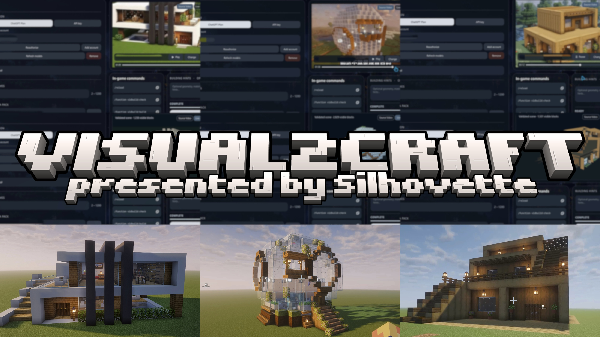
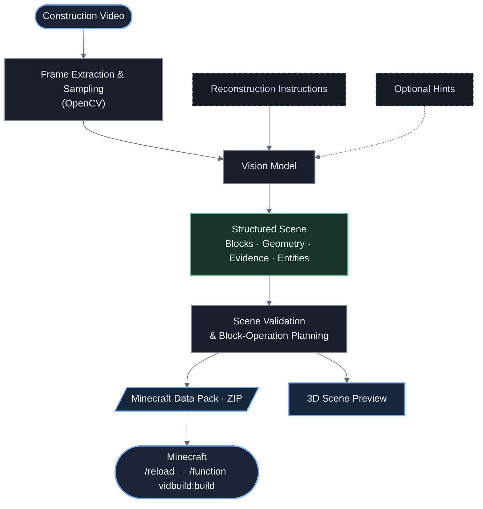

<p align="center">
  
</p>

# Visual2Craft：From Construction Videos to Executable Minecraft Builds

**Visual2Craft** is a desktop application that turns Minecraft building videos into executable Minecraft: Java Edition Data Packs. It samples frames from a tutorial, uses a vision-capable AI model to reconstruct the visible structure, and generates in-game commands that place the resulting blocks.

The workflow runs without training or fine-tuning a custom model. Reconstruction is approximate: results depend on video visibility, camera movement, model capabilities, and the evidence available in the selected frames.

## Features

- **Video-to-build workflow:** Import a construction video, choose the number of frames, and export a ready-to-install Data Pack ZIP.
- **3D reconstruction preview:** Inspect the validated building scene in the desktop viewer alongside the source video. The scene is displayed when a complete reconstruction is available; it is not a live stream of the model's intermediate reasoning.
- **Flexible AI connection:** Sign in with a supported ChatGPT account or provide an OpenAI API key, then select the model used for reconstruction.
- **Evidence-aware placement:** Confirmed building operations are compiled into commands; uncertain or unsupported regions are left unchanged.
- **Minecraft block support:** Use standard block IDs and block states, including glass, water, stairs, slabs, and supported special blocks. Explicitly supported entities can also be placed.
- **Optional building hints:** Supply extra information about geometry, materials, or dimensions when the video alone is ambiguous.
- **In-game build and undo:** Generate functions to check, construct, and remove a build at its saved location.
- **Responsive desktop interface:** Qt Quick UI with video controls, model selection, generation status, command copying, and a separate generation worker.

## Requirements

- **Minecraft: Java Edition 26.3** for the generated Data Pack format. Compatibility with other game versions is not guaranteed.
- **64-bit Python 3.13** recommended; the Windows launcher also looks for Python 3.12, 3.11, or 3.14.
- Windows 11 or a Linux desktop with working Qt / Qt Multimedia support.
- Internet access for dependency installation, account sign-in, and AI inference.
- A compatible AI model accessible through your selected ChatGPT sign-in or OpenAI API connection.

The Python dependencies are listed in [`requirements.txt`](requirements.txt). The desktop interface uses PySide6 / Qt Quick; OpenCV handles video-frame extraction.

## Quick start

### Windows

1. Download or clone the project and extract it to a writable directory.
2. Install 64-bit Python 3.13. Make sure the Windows `py` launcher is available.
3. Double-click **`START_WINDOWS.bat`**. It creates a project-local `.venv`, installs dependencies, and launches Visual2Craft.
4. In **AI Connection**, choose **ChatGPT Plan** and sign in, or choose **API key** and enter your credentials. Select a compatible model.
5. Import a Minecraft construction video, set the frame count (2–1200; default: 500), and optionally enter building hints.
6. Choose the destination `.zip` file and click **Generate Data Pack**.
7. When generation completes, install the ZIP in your Minecraft world using the instructions below.

Do not launch the application directly from a compressed ZIP preview; extract the project first.

### Linux

From the project directory:

```bash
chmod +x START_LINUX.sh
./START_LINUX.sh
```

Alternatively, set up Python manually on either platform:

```bash
python -m venv .venv
python -m pip install -r requirements.txt
python app.py
```

Activate the virtual environment before running the `pip` and `python` commands in the manual setup. On Linux, use `python3` if `python` is unavailable. Qt Multimedia playback depends on the system's installed codecs.

## Use the generated Data Pack

1. Open the desired Minecraft world folder and find its `datapacks` directory (for a local Java world, typically `.minecraft/saves/<world>/datapacks/`).
2. Place the generated **ZIP file** inside `datapacks`. You do not need to extract it.
3. Open the world with commands enabled (or with operator permissions on a server).
4. Run the following commands in Minecraft:

```mcfunction
/reload
/function vidbuild:check
/function vidbuild:build
```

Run this command to remove the most recently recorded build:

```mcfunction
/function vidbuild:undo
```

**Important:** `undo` is not a world backup. It removes matching generated blocks, and generated blocks on the standing-ground layer are replaced with grass. It cannot restore terrain, structures, or other blocks overwritten during construction. It's recommended to back up the world before building, and remain near the structure when undoing so the relevant chunks are loaded.

The generated functions use the `vidbuild` namespace. The default build origin is offset from the player's position, and the Data Pack records its location for undo.

## How it works



The generated scene is bounded, validated, and translated into Minecraft commands. Regions that cannot be supported by the available evidence are preserved instead of being guessed as empty space. The Data Pack also contains build and undo functions; it does not require a Minecraft mod or server-side plugin.

Large-building capacity: scenes can span **512 × 384 × 512 blocks** (width × height × depth), with up to **100,663,296 bounding-box cells**, **8,000 block operations**, and **200,000 block commands** for each of build and undo. A cuboid operation can place many blocks; empty space inside the bounding box does not allocate a full voxel grid during compilation. Individual fill commands remain split into at most 4,096 cells. The desktop preview supports up to **1,000,000 visible blocks**; larger scenes still export, but their preview is unavailable. Large previews are loaded without the incremental build animation.

Reconstruction prioritizes the complete evidenced height and layout before small decorations. API requests no longer impose the application's former 20,000-token output cap; the selected model's output and context limits still apply. These capacities do not guarantee reconstruction accuracy. In Minecraft, choose a build elevation that fits the world's vertical range and ensure the affected chunks are loaded; exporting a scene does not extend the world's build limits or load distant chunks automatically.

Generation runs in a separate process so the desktop UI stays responsive. The application reports its current stage and elapsed time; it does **not** display an invented exact completion percentage. Canceling stops the local worker, but requests already accepted by a remote provider may still incur usage.

## Command-line usage

The reconstruction pipeline can also be used without the desktop UI.

**Compile an existing scene JSON into a Data Pack (no model request):**

```bash
python -m core.video2pack --scene examples/demo_house.json --out demo_house.zip
```

**Reconstruct a video using an OpenAI API key:**

```bash
# Set OPENAI_API_KEY in your shell before running this command.
python -m core.video2pack --video tutorial.mp4 --auth api --model gpt-5.5 --frames 300 --out build.zip
```

Use a model that is actually available to your API account. CLI ChatGPT authentication uses a locally saved account registration; signing in through the desktop app is the easiest setup path.

**Open the desktop UI with paths preselected:**

```bash
python app.py --video tutorial.mp4 --out build.zip
```

The CLI additionally accepts `--offset X Y Z` to control the in-game build offset and `--building-hints` for optional reconstruction instructions. Run `python -m core.video2pack --help` for all options.

## Project structure

| Path | Purpose |
| --- | --- |
| `app.py` | Desktop application entry point |
| `qml/` | Qt Quick interface and reusable components |
| `core/` | Python backend, Qt bridge, inference, authentication, and scene logic |
| `prompts/` | Reconstruction instructions and prompt assets |
| `data/vanilla_blocks_26_3.txt` | Minecraft block reference list |
| `examples/` | Example scene JSON files |
| `tests/` | Automated tests |
